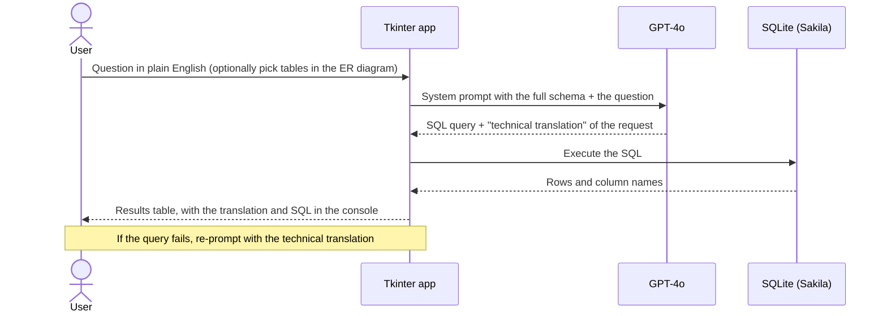

<div align="center">

# Natural Query Language

**Ask a database a question in plain English, and get the SQL and the answer.**<br>
A natural-language-to-SQL prototype built at ST Engineering: GPT-4o translates a request into
SQLite-compatible SQL, explains its approach, and runs it against the database from a desktop UI.

[](https://github.com/sp4ce-cowboy/natural-query-language/blob/626a70c4c86d0381546c51ad30493e2836447402/src/pgconnection.py)
[](https://github.com/sp4ce-cowboy/natural-query-language/blob/626a70c4c86d0381546c51ad30493e2836447402/src/pgconnection.py#L267-L328)
[](https://github.com/sp4ce-cowboy/natural-query-language/blob/626a70c4c86d0381546c51ad30493e2836447402/src/pgconnection.py#L178-L227)
[](https://github.com/sp4ce-cowboy/natural-query-language/blob/626a70c4c86d0381546c51ad30493e2836447402/src/pgconnection.py#L370-L466)
[](https://github.com/sp4ce-cowboy/natural-query-language/blob/626a70c4c86d0381546c51ad30493e2836447402/src/pgconnection.py#L370-L384)


</div>

> [!NOTE]
> This consolidated README page was added by
> [Claude](https://docs.anthropic.com/en/docs/claude-code) on 9 Nov 2026 using the
> [agentic-repo-analysis](https://github.com/sp4ce-cowboy/agentic-workflows) skill, from the
> project's code, git history and documentation. The project itself is from Aug 2024 – Jan 2025. The
> original README, the team's project proposal, is in **[DOCUMENTATION.md](DOCUMENTATION.md)**, and
> the detailed design is in [docs/](docs).

## At a glance

| | |
|---|---|
| **What** | A desktop tool that turns natural-language questions into SQL with an LLM, runs them, and shows the results |
| **Where** | ST Engineering, Singapore (internship project, Sep–Dec 2024) |
| **Team** | Two interns, who planned and designed it together for their supervisor |
| **Database** | The Sakila sample database (SQLite): films, actors, customers, rentals, payments |
| **Status** | Working prototype, with a multi-agent design for the next version |

## How it works



- **Schema in the prompt.** The database schema is parsed from a text file and put in the
  system prompt. The model must answer with SQLite-only SQL, with no markdown and no
  comments, or give no query at all if the request is outside the schema.
- **A technical translation.** Alongside the SQL, the model restates the request the way
  an SQL expert would, so the user can check the approach before trusting the result.
- **Re-prompting.** When a query fails, one click sends the technical translation back
  with a request for a corrected query. The conversation is kept in a JSON chat history.
- **UI.** A query box, an ER-diagram panel for selecting tables, a results table
  (`ttk.Treeview`), and a console window logging each step.

## The multi-agent design

The next version ([docs/multi_agent.md](docs/multi_agent.md)) splits the work across agents.
Long prompts make LLMs hallucinate, and one prompt can't handle every failure mode.

| Agent | Job |
|---|---|
| **Selector** | Maps the entities and relationships in the question to tables and columns in the schema, and asks for details if any are missing |
| **Decomposer** | Breaks complex questions into simpler ones with reasoning chains |
| **Error handler** | Takes an execution error and the last SQL, and repairs the query against the schema |
| **Query separator** | Splits a "show me a chart of…" request into a data query and a visualisation task |
| **Data visualiser** | Writes the plotting script for the rows the final SQL returns |


## Skills shown

| Skill | Where it shows (click the links for the code) | Docs |
|---|---|---|
| **LLM integration & prompt engineering**<br> | A system prompt with schema context, output constraints and a dual answer (SQL + translation): [`get_sql_query`](https://github.com/sp4ce-cowboy/natural-query-language/blob/626a70c4c86d0381546c51ad30493e2836447402/src/pgconnection.py#L267-L328) | [Chat Completions](https://platform.openai.com/docs/api-reference/chat) |
| **Text-to-SQL**<br> | Generated SQL executed against the Sakila schema, with results rendered generically from the cursor's columns: [`execute_query`](https://github.com/sp4ce-cowboy/natural-query-language/blob/626a70c4c86d0381546c51ad30493e2836447402/src/pgconnection.py#L178-L227) | [sqlite3](https://docs.python.org/3/library/sqlite3.html) |
| **Error recovery** | Failed queries re-prompted with the model's own technical translation, and a persistent chat history: [`reprompt_query`, chat history](https://github.com/sp4ce-cowboy/natural-query-language/blob/626a70c4c86d0381546c51ad30493e2836447402/src/pgconnection.py#L229-L265) | — |
| **Desktop UI**<br> | An ER-diagram table picker, a results `Treeview` and a logging console: [widgets](https://github.com/sp4ce-cowboy/natural-query-language/blob/626a70c4c86d0381546c51ad30493e2836447402/src/pgconnection.py#L370-L466) | [tkinter](https://docs.python.org/3/library/tkinter.html) |
| **Multi-agent LLM design** | Five agents, each with one concern: [docs/multi_agent.md](docs/multi_agent.md) | — |
| **Software design docs** | Proposal, architecture and sequence diagrams: [DOCUMENTATION.md](DOCUMENTATION.md), [docs/](docs) | — |

## Getting started

```sh
pip install openai pillow
echo 'api_key = "sk-..."' > src/apikey.py   # your OpenAI key; apikey.py is git-ignored
cd src && python pgconnection.py
```
